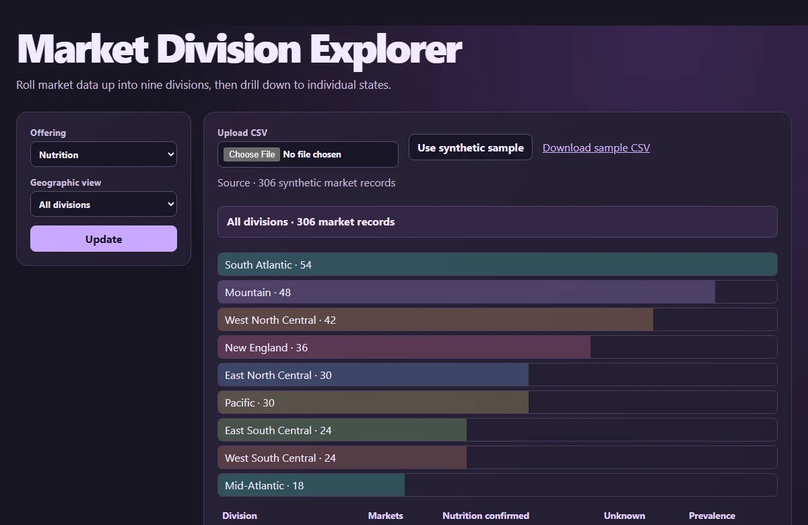

# Market Division Explorer

Roll market data up into nine divisions, then drill down to individual states.

[Open the web app](https://surfingcoder.com/apps/market-division-explorer/)



## Run locally

Serve the repository with Python 3, then open http://127.0.0.1:8000/ in a current browser.

```sh
python -m http.server 8000 --bind 127.0.0.1
```

Start with the provided example. Adjust the controls and select **Update** to recompute. Sliders refresh the result as you move them.

To use your own data, upload a CSV with a two-letter US **State** column and source offering flags such as **SNAP**, **Fruit**, **Flowers**, and **Crafts**. Header matching ignores case. Use **Y**, **N**, or leave unknown values blank. The downloadable synthetic example shows all supported headers. CSV processing stays in your browser.

## Method

The hierarchy maps two-letter state codes to nine geographic divisions. Prevalence divides confirmed positives by records whose offering is known. Total records and unknown counts remain visible.

## Verify

Run `node --test check.mjs` with Node.js 22 or newer. The check runs the app’s mathematical regression cases without a browser.
